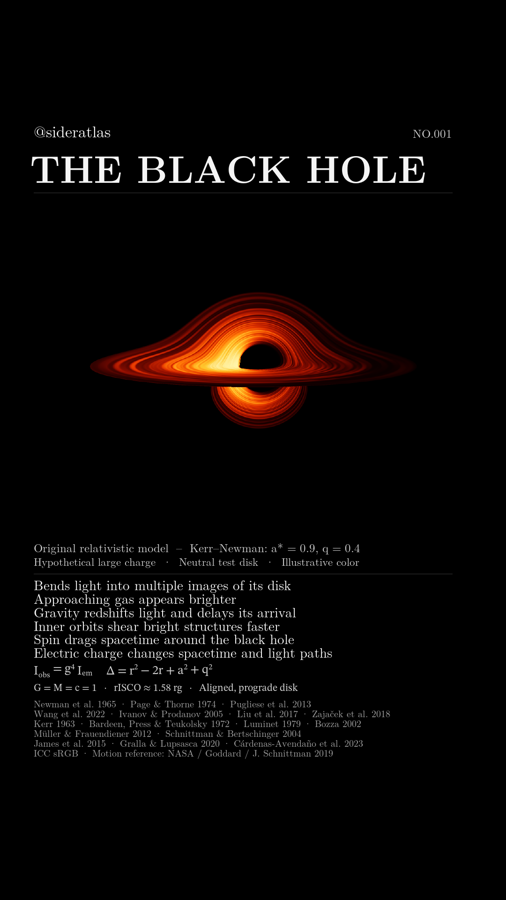

# Sideratlas — The Black Hole

Original relativistic black-hole visualizations for **@sideratlas**, with Python and C++ source, finished Instagram Reels, scientific references, and numerical checks.

The current release follows light through a **Kerr–Newman spacetime with $a_*=0.9$ and $q=0.4$**. Its viewpoint completes a full revolution around an evolving, aligned, prograde disk. Each 32-second video repeats one eight-second cycle four times.

<a href="https://github.com/Loganpis/sideratlas-black-hole/releases/tag/v1.0.0"></a>

**[Download the videos and complete project](https://github.com/Loganpis/sideratlas-black-hole/releases/tag/v1.0.0)** · **[Scientific model and sources](README-KERR-NEWMAN.md)** · **[Instagram caption](caption-kerr-newman.txt)**

## Current release

| File | Contents |
| --- | --- |
| [Orange Reel](output-sideratlas-kn/sideratlas-kerr-newman-reel.mp4) | 32 seconds, illustrative brightness palette |
| [Monochrome Reel](output-sideratlas-kn/sideratlas-kerr-newman-intensity.mp4) | The same calculated radiance in monochrome |
| [Orange loop](output-sideratlas-kn/sideratlas-kerr-newman-reel-loop.mp4) / [monochrome loop](output-sideratlas-kn/sideratlas-kerr-newman-intensity-loop.mp4) | Original eight-second cycles |
| [Orbit review](output-sideratlas-kn/orbit-review.jpg) | Twelve views sampled from the encoded video |
| [Model metadata](output-sideratlas-kn/render-metadata.json) | Physical parameters, display choices, and source provenance |
| [Delivery verification](output-sideratlas-kn/verification.json) | Numerical, provenance, and finished-video checks |

Videos are **1080 × 1920, 30 fps**, silent H.264 MP4s, with Rec.709 color tagging and fast-start playback. The black background, Latin Modern/STIX typography, and text margins are designed for a vertical Reel. See [export and posting notes](INSTAGRAM-EXPORT.md).

## What is calculated

The code recalculates null-geodesic light paths, multiple disk images, propagation delays, gravitational and Doppler frequency shifts, neutral circular orbits, the ISCO, and the mean radial emission profile for the selected charged, rotating geometry. Emission is sampled at each ray's retarded source time. Frame dragging follows from the metric.

**This is a hypothetical large-charge configuration with a neutral test disk.** The infinitesimally thin, opaque disk has prescribed, finite-lived shearing brightness patches. It is not a fluid or magnetohydrodynamic simulation, and does not calculate plasma forces or charge discharge. Orange indicates illustrative bolometric brightness, not a predicted visible spectrum. These assumptions are also disclosed in the video and caption.

The detailed [model document](README-KERR-NEWMAN.md) gives equations, parameter conventions, omissions, and the role of every cited study. NASA Goddard / Jeremy Schnittman's [2019 visualization](https://svs.gsfc.nasa.gov/13326/) inspired the viewpoint motion and presentation. This project uses original calculations; no NASA footage, textures, simulation data, or code is bundled.

## Reproduce the current model

The project was run with Python 3.12. It requires NumPy, Pillow, a C++17 compiler (`clang++` or `g++`), and FFmpeg/FFprobe on your PATH. FFmpeg needs `libx264` and the `zscale` filter. The C++ kernel compiles automatically when needed. macOS was used for the delivered render; other platforms have not been verified for this release.

```sh
git clone https://github.com/Loganpis/sideratlas-black-hole.git
cd sideratlas-black-hole
python3 -m venv .venv
source .venv/bin/activate
python3 -m pip install -r requirements.txt

python3 verify_kn_trace.py
python3 verify_kn_orbit_emission.py
python3 render_kn_orbit.py
python3 verify_kn_orbit.py
```

For a small set of preview stills:

```sh
python3 render_kn_orbit.py --preview --width 540 --supersample 1 --output output-sideratlas-kn/preview
```

The full render uses a 2160 × 1800 physical detector before radiance averaging and composition into the 1080 × 1920 frame. It calculates 120 independent geometric views and uses the exact antipodal symmetry of this model for the other 120, reevaluating emission at each view's own position and time. It generates several gigabytes of resumable caches, which are excluded from Git. Running the default commands replaces the corresponding generated outputs and reports.

`review_kn_video.py` compares decoded frames against the cached physical radiance; regenerate that cache with a full render before running this optional review. Its recorded results and review images are already included.

The delivered release passed **62 ray-tracing checks**, **69 orbital/emission checks**, and **75 renderer, provenance, and delivery checks**. Both 32-second files decode to 960 frames, with four pixel-identical copies of their respective cycles. These tests establish numerical consistency and export integrity for the stated model; they do not validate the physics of charged accretion plasma.

To rebuild the downloadable bundle after verification:

```sh
python3 package_kn_release.py
```

## Project files and earlier versions

| Location | Role |
| --- | --- |
| `render_kn_orbit.py`, `kn_orbit_trace.py/.cpp`, `kn_orbits.py`, `kn_orbit_emission.py` | Current Kerr–Newman renderer, geodesics, orbits, and emission |
| `verify_kn_*.py`, `*-diagnostics.json` | Independent numerical checks and recorded results |
| `instagram_export.py`, `review_kn_video.py` | Video export and decoded-frame review |
| `output-sideratlas-kn/` | Current Kerr–Newman media and reports |
| `output-sideratlas/`, `output-schwarzschild/` | Earlier Schwarzschild viewpoint animations; [documentation](README-SCHWARZSCHILD.md) |
| `output-kerr/` | Earlier Kerr optical experiments; [documentation](README-KERR.md) |
| `render_kerr_orbit.py` | Intermediate rotating, uncharged model; [documentation](README-KERR-ORBIT.md) |
| `output-optical/` | Earlier spectral/optical experiments; [documentation](README-OPTICAL.md) |
| `output/` | Initial visualization; [historical README](README-LEGACY.md) |
| `fonts/`, `data/` | Bundled fonts, color-matching data, licenses, and attribution |

Earlier versions retain their original filenames and branding. Their assumptions, captions, and test reports apply to those versions, not to the current charged model. Historical source ZIPs and disposable render caches are omitted; the repository and current release archive contain the source and completed media.

See [publication provenance](PUBLICATION.md) for the scope of the public copy and [third-party notices](THIRD-PARTY-NOTICES.md) for bundled asset licensing.
