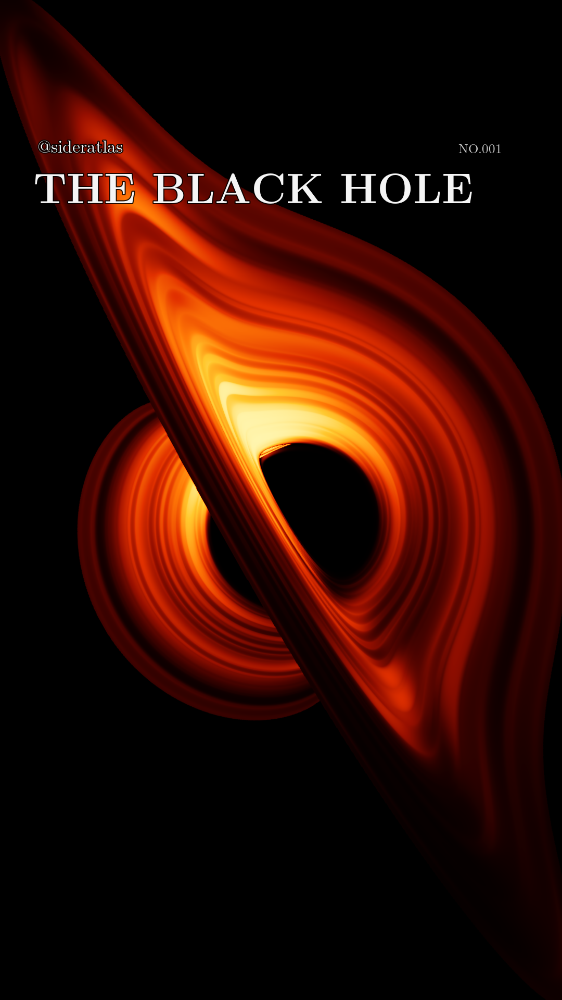

# Sideratlas — The Black Hole

Original relativistic black-hole visualizations for **@sideratlas**, with Python and C++ source, finished Instagram Reels, scientific references and numerical checks.

**Version 1.2.0** follows light through a **Kerr–Newman spacetime with $a_*=0.9$ and $q=0.4$** around an evolving, aligned, prograde neutral test disk. Restrained spiral structure now accretes inward, gas follows calculated plunging trajectories inside the ISCO, and multiple lensed images pass through the inner emitting layer. The diagonal simulation fills the portrait frame behind the account name, number and title. Each 32-second movie repeats one eight-second cycle four times.

<a href="https://github.com/Loganpis/sideratlas-black-hole/releases/tag/v1.2.0"></a>

**[Download v1.2.0](https://github.com/Loganpis/sideratlas-black-hole/releases/tag/v1.2.0)** · **[Scientific model and sources](README-V1.2.0.md)** · **[Instagram description (.text)](caption-kerr-newman.text)**

## Current release

| File | Contents |
| --- | --- |
| [Orange Reel](output-sideratlas-kn-v120/sideratlas-kerr-newman-reel.mp4) | 32 seconds, illustrative brightness palette |
| [Monochrome Reel](output-sideratlas-kn-v120/sideratlas-kerr-newman-intensity.mp4) | The same calculated radiance in monochrome |
| [Orange loop](output-sideratlas-kn-v120/sideratlas-kerr-newman-reel-loop.mp4) / [monochrome loop](output-sideratlas-kn-v120/sideratlas-kerr-newman-intensity-loop.mp4) | Original eight-second cycles |
| [Model metadata](output-sideratlas-kn-v120/render-metadata.json) | Physical parameters, source, transfer and sampling choices |
| [Delivery verification](output-sideratlas-kn-v120/verification.json) | Finished-video and numerical provenance checks |
| [Description](caption-kerr-newman.text) | Explanations, assumptions, all study credits and repository link |

The delivery remains **1080 × 1920, 30 fps**, silent H.264 MP4, Rec.709 tagged, with fast-start playback. The black sky, Latin Modern/STIX typography, fixed exposure and smooth full viewpoint revolution are retained. There is no lower text block. The close portrait crop can exclude the outer disk during some views, especially near the poles. See [export and posting notes](INSTAGRAM-EXPORT.md).

## What changed in v1.2.0

- **Accretion and irregularity:** localized brightness packets at several scales and coherent spiral structure are transported along a small prescribed radial drift and calculated differential rotation. Their emitted azimuthal mean preserves the existing exterior Page–Thorne profile
- **Luminous plunge:** a continuously matched ISCO launch initializes exact neutral timelike geodesics. Radial emitter motion enters the frequency shift, with per-ray retarded times and photon capture. The horizon itself never emits
- **Multiple images:** actual photon trajectories record the thin inner layer's crossings until capture, escape or the first opaque outer disk. Gray-slab transfer combines the images. Extra independent subpixel rays resolve narrow structures where possible; no band count or stripe shape is imposed

**Calculated effects and emission choices are distinguished throughout the [model document](README-V1.2.0.md).** The metric, null paths, inner geodesic motion, frequency shifts and delays are calculated. The slow exterior drift, smooth emissivity fluctuations, weak inner heating and normal optical depth are illustrative prescriptions. The original circular-orbit Page–Thorne profile remains a thin-disk brightness background, not an exact viscous solution for the flowing matter.

The [controlled texture comparison](output-sideratlas-kn-v120/emission-comparison.jpg) uses identical photon paths for all three source prescriptions. Its [source statistics](kn-emission-comparison-diagnostics.json) and the separate [image-order checks](kn-image-order-diagnostics.json) distinguish restored disk detail from actual higher-order lensing.

**The large charge is hypothetical and all emitters are neutral test matter.** This code does not solve plasma forces, MHD/MRI, thermodynamics or charge discharge. Orange denotes illustrative bolometric brightness, not predicted visible color. Higher-order bands can be narrower than a final pixel, and their visibility depends on opacity and source structure. The description explains these limits; post it with the video.

NASA Goddard / Jeremy Schnittman's [2019 visualization](https://svs.gsfc.nasa.gov/13326/) inspired the viewpoint motion and presentation. This project uses original calculations; no NASA footage, textures, simulation data or code is bundled.

## Reproduce v1.2.0

The delivered project uses Python 3.12, NumPy, Pillow, a C++17 compiler (`clang++` or `g++`), and FFmpeg/FFprobe on your PATH. FFmpeg needs `libx264` and the `zscale` filter. The C++ kernel compiles automatically. The release was produced on macOS; other platforms have not been verified for this delivery.

```sh
git clone https://github.com/Loganpis/sideratlas-black-hole.git
cd sideratlas-black-hole
python3 -m venv .venv
source .venv/bin/activate
python3 -m pip install -r requirements.txt

python3 verify_kn_trace.py
python3 verify_kn_orbit_emission.py
python3 verify_kn_flow.py
python3 verify_kn_dynamic_emission.py
python3 verify_kn_accretion_trace.py
python3 verify_kn_sampling.py
python3 verify_kn_image_orders.py
python3 compare_kn_emission.py
python3 render_kn_accretion.py
# Optional after a complete native cache: rebuild delivery media without retracing rays
python3 assemble_kn_accretion.py
python3 verify_kn_accretion.py
python3 review_kn_accretion_video.py
python3 package_kn_accretion_release.py
```

The physical entry point for this release is **`render_kn_accretion.py`**. Resumable numerical caches are excluded from Git. Rendering regenerates the corresponding outputs; it can take substantial time. After the native cache is complete, `assemble_kn_accretion.py` verifies and hashes every float-radiance frame and rebuilds the media with the unchanged compositor and encoder, without retracing photons or changing radiance. The old `render_kn_orbit.py` remains the v1.1.0 renderer and does not produce the new accretion/plunge model.

`package_kn_accretion_release.py` produces `sideratlas-kerr-newman-v1.2.0-source.zip` after the completed delivery has passed verification. The decoded-frame review requires the radiance cache created by the render. A small still preview is available with `python3 render_kn_accretion.py --preview --width 540 --supersample 1.5 --output output-sideratlas-kn-v120/preview`.

Independent checks cover orbit and flux limits, timelike normalization, conserved plunge energy and momentum, radial geodesic acceleration, redshift signs, streamline transport, preserved exterior mean, multi-hit paths, numerical refinement and event capacity. The report files identify the checked source hashes. Finished-video reports record the actual encoding, repeated cycles and delivery results. These establish consistency within the declared model, not validation of charged accretion plasma or of the illustrative heating prescription.

## Project files and earlier versions

| Location | Role |
| --- | --- |
| `render_kn_accretion.py` | Current v1.2.0 render and export entry point |
| `assemble_kn_accretion.py` | Verified cache-to-video assembly with unchanged radiance |
| `kn_accretion_trace.py/.cpp` | Multiple-event Kerr–Newman null tracing and signed radial photon momentum |
| `kn_flow.py` | Normalized exterior drift and exact neutral geodesic plunge |
| `kn_dynamic_emission.py` | Advected restrained structure, exterior Page–Thorne background and declared inner heating |
| `kn_orbits.py`, `kn_orbit_emission.py` | Shared neutral circular quantities, ISCO and Page–Thorne integral |
| `verify_kn_*.py`, `*-diagnostics.json` | Independent checks and source-identified reports |
| `output-sideratlas-kn-v120/` | Current v1.2.0 media and reports |
| `render_kn_orbit.py`, `output-sideratlas-kn/` | Prior v1.1.0 Kerr–Newman model; [documentation](README-KERR-NEWMAN.md) |
| `output-sideratlas/`, `output-schwarzschild/` | Earlier Schwarzschild viewpoint animations; [documentation](README-SCHWARZSCHILD.md) |
| `output-kerr/`, `render_kerr_orbit.py` | Earlier uncharged Kerr work; [optical](README-KERR.md) and [viewpoint](README-KERR-ORBIT.md) documentation |
| `output-optical/`, `output/` | Earlier [spectral experiments](README-OPTICAL.md) and [initial visualization](README-LEGACY.md) |
| `fonts/`, `data/` | Bundled fonts, color-matching data, licenses and attribution |

Earlier source and completed media remain available with their historical assumptions and branding. Historical reports apply to their own identified models. The [v1.1.0 release](https://github.com/Loganpis/sideratlas-black-hole/releases/tag/v1.1.0) preserves the circular-emitter diagonal animation; [v1.0.0](https://github.com/Loganpis/sideratlas-black-hole/releases/tag/v1.0.0) preserves the smaller horizontal layout with explanatory text below it. Duplicate historical source ZIPs and disposable caches are omitted from the repository.

The [v1.2.0 model document](README-V1.2.0.md) records every study's role, equations and limitations. See [publication provenance](PUBLICATION.md) and [third-party notices](THIRD-PARTY-NOTICES.md) for the public copy and bundled asset licensing.
